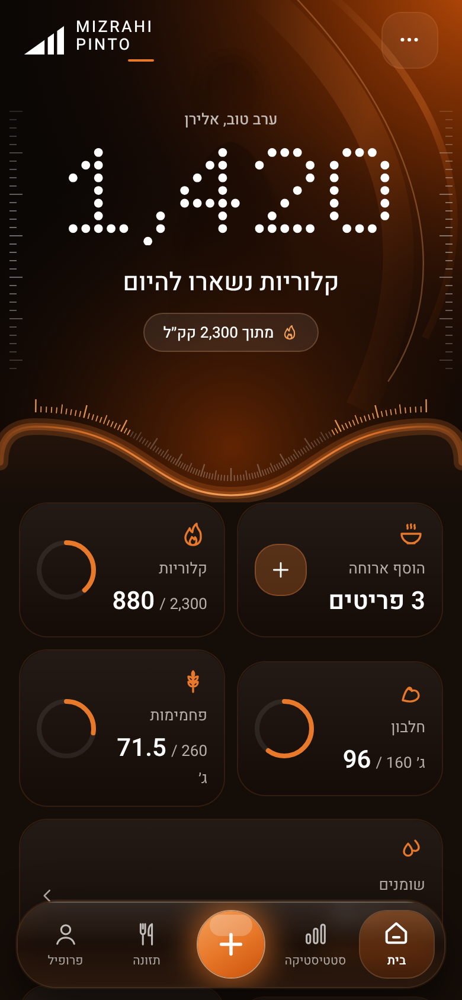
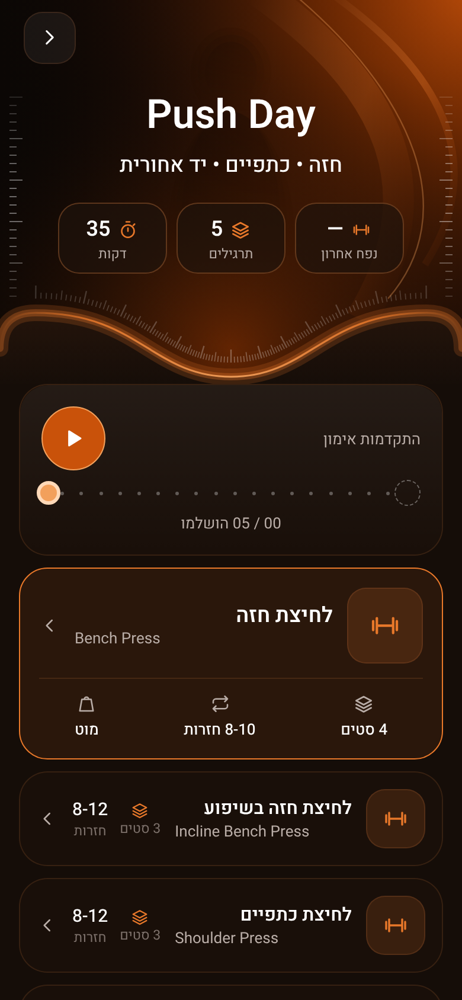
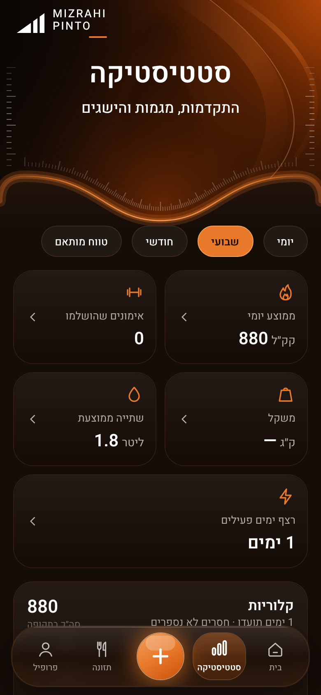
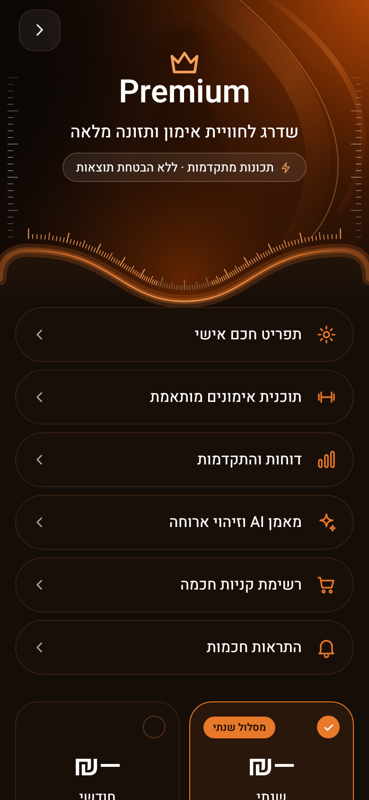

# MIZRAHI PINTO

אפליקציית כושר, תזונה ותכנון שגרה בעברית (RTL) לאייפון – React Native + Expo + TypeScript.
עיצוב: שחור חם, כתום גחלים (לפי מסך הבית המאושר), מספרי Dot-Matrix, גל שקוע בצורת U, כרטיסי Bento וסרגל ניווט צף בסגנון Liquid Glass.

<p>
   
</p>

---

## פתיחה באייפון כאתר (בלי התקנה)

**https://mizrahi854.github.io/Mizrahi-pinto/**

1. פתח את הקישור ב-**Safari** באייפון.
2. כפתור השיתוף (ריבוע עם חץ למעלה) ← **"הוספה למסך הבית"** ← הוסף.
3. האייקון של MIZRAHI PINTO יופיע במסך הבית ויפתח במסך מלא, כמו אפליקציה.

האתר מתעדכן אוטומטית בכל דחיפה לענף (GitHub Actions בונה ומפרסם לענף `gh-pages`).
הערות לגרסת האתר: הנתונים נשמרים בדפדפן של המכשיר; סריקת ברקוד במצלמה והתראות זמינות רק באפליקציה (Expo Go) – באתר אפשר להקליד ברקוד.

## פריסה ב-Vercel (חינם)
1. היכנס ל-https://vercel.com/new (התחברות עם GitHub).
2. Import ← `mizrahi854/Mizrahi-pinto` ← Deploy. ההגדרות כבר בקובץ `vercel.json` – אין צורך לשנות כלום.
3. תקבל קישור בסגנון `https://mizrahi-pinto.vercel.app` – פותחים בספארי ← שיתוף ← הוספה למסך הבית.

## פתיחה באייפון (Expo Go)

1. באייפון: התקן את **Expo Go** מה-App Store.
2. במחשב (Mac או Windows) עם [Node.js 20+](https://nodejs.org):
   ```bash
   git clone https://github.com/mizrahi854/Mizrahi-pinto.git
   cd Mizrahi-pinto
   git checkout claude/gifted-faraday-9paqnk
   npm install
   npx expo start
   ```
3. סרוק את קוד ה-QR שמופיע בטרמינל עם **מצלמת האייפון** → "פתח ב-Expo Go".
   - האייפון והמחשב צריכים להיות על אותה רשת Wi-Fi.
   - אם הרשת חוסמת: `npx expo start --tunnel`.
4. בפעם הראשונה: "המשך בלי חשבון" → שאלון → מסך הבית.

> Expo Go צריך להיות בגרסה שתומכת ב-Expo SDK 58 (הגרסה העדכנית ב-App Store). אם מופיעה שגיאת גרסה – עדכן את Expo Go.

### התקנה כאפליקציה עצמאית (בלי מחשב פתוח)
```bash
npm i -g eas-cli
eas login            # חשבון Expo חינמי
eas build --profile preview --platform ios
```
דורש Apple Developer Account (בתשלום של אפל) להתקנה על מכשיר. לא בוצע עדיין – דורש את אישורך ופרטי החשבון שלך.

---

## פקודות

| פקודה | מה עושה |
|---|---|
| `npm start` | שרת פיתוח (QR ל-Expo Go) |
| `npm run web` | תצוגה בדפדפן (לבדיקות מהירות) |
| `npm run typecheck` | TypeScript strict |
| `npm run lint` | ESLint (expo config) |
| `npm test` | בדיקות יחידה (חישובי תזונה, תאריכים, מאגר, שיאים, אתגרים) |

## מבנה הפרויקט

```
src/
  app/                 מסכים (Expo Router) – כל קובץ = מסך
    (auth)/            ברוכים הבאים, הרשמה, התחברות, איפוס, אימות
    (tabs)/            בית, סטטיסטיקה, תזונה, פרופיל + סרגל ניווט
    onboarding.tsx     שאלון התאמה (מסכים נפרדים, שמירה אוטומטית)
    food/ recipe/ workout/ exercise/ victory/ stats/ macro/ …
  components/          Design system: DotMatrix, WaveHeader, HeroScreen, NavBar, BodyMap, Charts, RulerPicker, WheelPicker, ui
  theme/tokens.ts      צבעים, טיפוגרפיה, רדיוסים
  data/                108 מוצרי בסיס, תרגילים, תוכניות, מתכונים, טיפוסים
  store/               Zustand + AsyncStorage (offline-first), selectors
  lib/                 nutrition, dates, stats, records, challenge, notifications, auth, supabase, sync, openFoodFacts
supabase/
  migrations/          סכימה מלאה + RLS לכל טבלה + Storage פרטי
  functions/delete-account/   מחיקת חשבון בצד שרת
docs/
  FEATURES.md          סטטוס כל דרישה ומסך
  screenshots/         צילומי מסך
  design_reference/    ההדמיות המאושרות
```

## חיבור Supabase (כשתרצה)

כרגע האפליקציה עובדת **מקומית בלבד** (הנתונים במכשיר). לא נוצר פרויקט Supabase – בחשבון שלך כבר יש 2 פרויקטים חינמיים פעילים (yoske, rimov) וזה המקסימום בתוכנית החינמית. לא נגעתי בהם.

כדי לחבר:
1. צור פרויקט (אחרי השהיית אחד הקיימים, או בארגון/חשבון אחר) ב-[supabase.com](https://supabase.com).
2. SQL Editor → הרץ את `supabase/migrations/20261124000000_init.sql` (או `supabase db push` עם ה-CLI).
3. פרוס את פונקציית מחיקת החשבון: `supabase functions deploy delete-account`.
4. צור `.env` לפי `.env.example` עם ה-URL והמפתח הציבורי (publishable/anon) בלבד.
5. Authentication → Email: הפעל אישור מייל.
6. הפעל מחדש `npx expo start` – ההרשמה, האימות במייל, איפוס הסיסמה והסנכרון יופעלו אוטומטית.

אבטחה: RLS על כל טבלה פרטית (משתמש רואה רק את שלו), Premium נקבע רק בצד שרת (`entitlements` ללא מדיניות כתיבה ללקוח), תמונות ב-bucket פרטי לפי תיקיית משתמש, מפתח service-role רק בפונקציית השרת.

## עקרונות נתונים
- ערך תזונתי חסר **לא** נספר כאפס – הסכום מסומן כחלקי (*).
- ערכי מאגר הבסיס הם ערכי ייחוס כלליים ומסומנים "לא מאומת". מוצרים ממותגים (שייקים, GO, PRO, חטיפים) **ללא ערכים** עד סריקת ברקוד (Open Food Facts) או הזנה מהתווית. אין ברקודים או תמונות מומצאים.
- מתחת לגיל 18: אין יעדי קלוריות, אין מדידות גוף, אין הפחתה עתידית.
- אכילה מעל יעד לא מורידה מהימים הבאים. אתגרים מבוססי התמדה בלבד.
- Premium: כפתור "שדרג" הוא Placeholder – אין רכישה, אין חיוב, אין הענקת מנוי.
